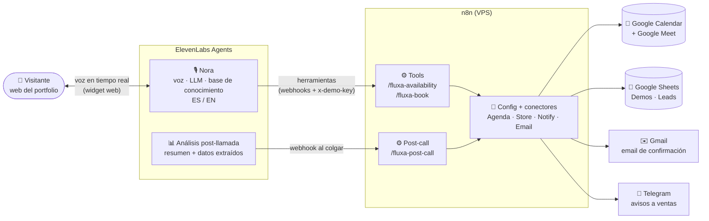
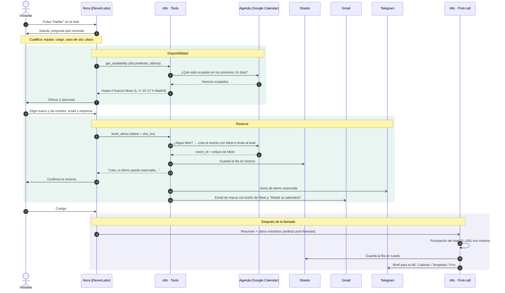
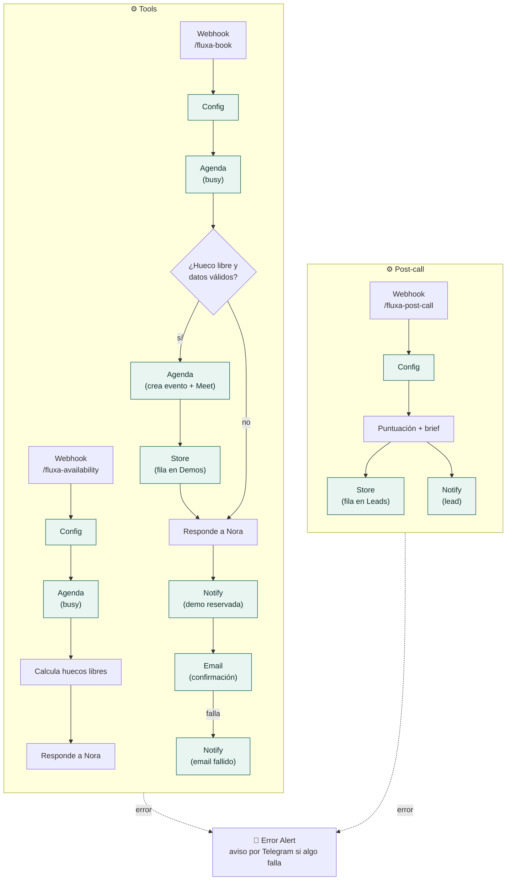

# Arquitectura y flujo de Nora (Fluxa voice agent)

Este documento explica el sistema completo con tres diagramas. GitHub los dibuja solo, porque son bloques Mermaid.

1. **Vista general:** qué piezas hay y cómo se conectan.
2. **Una llamada paso a paso:** qué ocurre desde que el visitante pulsa "Hablar" hasta que ventas recibe el aviso.
3. **Dentro de n8n:** cómo están organizados los workflows y los conectores intercambiables.

> Fluxa es una empresa ficticia. Los IDs, claves y chats reales viven solo en n8n y ElevenLabs, nunca en este repo.

---

## 1. Vista general

**En una frase:** Nora habla con el visitante y, cuando necesita hacer algo (ver huecos o reservar), llama a n8n. Al colgar, ElevenLabs manda el análisis de la llamada a n8n, que puntúa el lead, lo guarda y avisa a ventas.

| Pieza | Qué hace |
|---|---|
| **ElevenLabs** | Voz (STT/TTS), el LLM que conversa, la base de conocimiento de Fluxa y el análisis post-llamada. |
| **n8n · Tools** | Responde en tiempo real a las dos herramientas de Nora: `get_availability` y `book_demo`. |
| **n8n · Post-call** | Recibe el análisis al terminar la llamada, calcula la puntuación del lead y genera el brief para ventas. |
| **n8n · Config** | El único sitio que se edita por cliente: marca, horario, puntuación y qué herramienta hace cada función. |
| **Conectores** | Sub-workflows con entrada y salida fijas: **Agenda** (Google Calendar o Sheets), **Store** (Sheets), **Notify** (Telegram) y **Email** (Gmail). |

---

## 2. Una llamada, paso a paso

**Detalles que importan:**
- **Seguridad:** cada llamada de herramienta lleva la cabecera `x-demo-key`. Si no coincide con la de Config, n8n no ofrece ni reserva nada.
- **Sin dobles reservas:** antes de reservar, n8n vuelve a leer el calendario. Si el hueco ya se ocupó, Nora ofrece otro.
- **No bloquea la llamada:** Nora responde en cuanto la reserva queda guardada. El aviso por Telegram y el email salen después.
- **Errores visibles:** si Gmail falla, llega un aviso por Telegram. Si un workflow falla, el workflow **Error Alert** avisa con el detalle.

---

## 3. Dentro de n8n

Los recuadros verdes son **sub-workflows** (Config y los conectores Agenda, Store, Notify y Email).

**Versión todo en uno:** `n8n/fluxa-all-in-one.json` contiene todo esto en un solo workflow. Los conectores están dentro, detrás de un único disparador, y cada llamada se hace al mismo workflow pasando por un nodo `→ conector` que indica a cuál va. Se genera con el mismo script, así que las dos versiones nunca se desincronizan. Guía: [instalacion.md](instalacion.md).

**Por qué está hecho así:** Tools y Post-call no saben qué herramienta hay detrás. Llaman a un conector (por ejemplo, Agenda) que siempre recibe y devuelve lo mismo. Para cambiar de Google Calendar a Outlook o Cal.com basta con añadir una rama en ese conector y cambiar una línea en Config. El resto no se toca.

| Workflow | Disparador | Función |
|---|---|---|
| Fluxa Voice Agent · Tools | Webhooks de las herramientas de Nora | Disponibilidad y reserva en tiempo real |
| Fluxa Voice Agent · Post-call | Webhook post-llamada de ElevenLabs | Puntuación, Leads y aviso a ventas |
| Fluxa Voice Agent · Config | Llamado por los anteriores | Configuración única por cliente |
| Fluxa Voice Agent · Agenda / Store / Notify / Email | Llamados por los anteriores | Conectores intercambiables |
| Fluxa Voice Agent · Error Alert | Error en Tools o Post-call | Aviso por Telegram |
| Fluxa Voice Agent · Self-test | Manual | Prueba de extremo a extremo sin gastar minutos de voz |

Más detalle: [setup](setup.md) · [flujos de conversación](specs/03-flows.md) · [esquema de datos](specs/05-data-schema.md) · [adaptar a clientes](adaptar-a-clientes.md).
